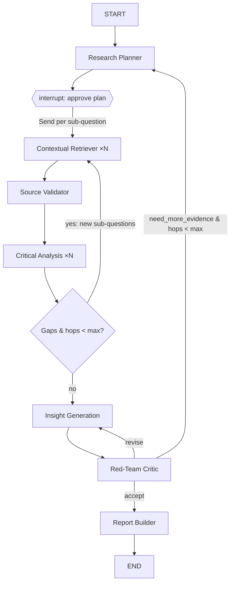

# Multi-Agent AI Deep Researcher — Implementation Plan

An AI research assistant for multi-hop, multi-source investigations. A user asks a
hard question ("How is the EU AI Act changing hiring practices in fintech, and what
does the evidence say about outcomes?"); a team of specialised agents plans the
investigation, retrieves from papers, news, reports and APIs, cross-checks the
evidence, generates hypotheses, and compiles a cited report.

Showcases: **agent collaboration** (explicit graph with fan-out/fan-in and feedback
loops), **retrieval-augmented reasoning** (every claim grounded in an evidence ID
from a vector store), and **long-context synthesis** (hierarchical map-reduce
summarisation over a large evidence corpus).

---

## 1. Framework and stack decisions

| Concern | Choice | Why |
|---|---|---|
| Orchestration | **LangGraph** `StateGraph` (hand-built graph, not `create_supervisor`) | An explicit graph makes the collaboration visible and deterministic. `Send` gives parallel fan-out, conditional edges give the multi-hop loop, `interrupt()` gives human approval. Matches what you already learned in `agents/4_langgraph`. |
| LLMs | **OpenRouter** via `langchain-openrouter` (`src/deep_researcher/llm.py`). Tiers: heavy `anthropic/claude-opus-5.5`, worker `anthropic/claude-sonnet-5`, cheap `anthropic/claude-haiku-4.5`; per-role env overrides, model fallbacks, provider routing | One key for every vendor; swap a role's model with an env var; fallbacks keep a run alive when a provider is down. |
| Retrieval tools | arXiv API, Semantic Scholar API, Tavily (or Serper) web search, NewsAPI (or GDELT), Wikipedia, PDF fetcher (`pypdf`), optional domain APIs (e.g. FRED, Polygon) | Covers the four source types in the brief: papers, news, reports, APIs. |
| Evidence store | **Chroma, embedded and persistent** (`CHROMA_PATH`) via `src/deep_researcher/store/` | Zero-ops, survives restarts, same client for Chroma server/cloud; every chunk carries `evidence_id`, `url`, `source_type`, `published_at`, `credibility`; collection is fingerprinted with the embedding model. |
| Embeddings | **Local by default**: `BAAI/bge-small-en-v1.5` on CPU via `langchain-huggingface`; or Ollama (`nomic-embed-text`); or any OpenAI-compatible endpoint. `src/deep_researcher/embeddings.py` | Local dev needs no key for indexing; hosted runs switch provider with one env var. |
| Persistence | `SqliteSaver` checkpointer | Resume after human approval, re-run a failed node, inspect state per thread. |
| Observability | LangSmith tracing via `src/deep_researcher/tracing.py` | Required to debug a 7-agent graph; also gives eval datasets. See §11. |
| UI (local) | **Gradio** app (streaming node events + plan approval + report download) | Consistent with the course projects. CLI runner too. |
| UI (hosted) | **Vercel**: static `public/index.html` + FastAPI function in `api/index.py` streaming Server-Sent Events | Same graph, different front door. See §10. |
| Packaging | `uv`, Python ≥ 3.12, `python-dotenv` | Same conventions as `agents/pyproject.toml`. |

---

## 2. Agent roster

The four requested agents plus three additions (Planner, Source Validator, Red-Team Critic)
that make the system genuinely multi-hop and trustworthy.

| # | Agent | Tier (OpenRouter) | Input | Output | Notes |
|---|---|---|---|---|---|
| 1 | **Research Planner** (orchestrator) | heavy | user question | `ResearchPlan`: 3–7 sub-questions, each with suggested source types and a dependency hint | Structured output (Pydantic). Pauses with `interrupt()` so the user can edit/approve the plan. Also decides when to stop looping. |
| 2 | **Contextual Retriever** (×N in parallel) | worker | one sub-question | list of `Evidence` chunks written to Chroma | ReAct agent with the retrieval tools. One instance per sub-question via `Send`. Each tool result is chunked, embedded, de-duplicated (URL + simhash), and stored. |
| 3 | **Source Validator** | cheap | new evidence batch | credibility score 0–1, flags (primary/secondary, peer-reviewed, date, author/org, retracted?) | Cheap pass; rejects low-relevance chunks (LLM grader) so later agents see less noise. |
| 4 | **Critical Analysis** | heavy | sub-question + top-k evidence (RAG query) | per-sub-question `Summary` with cited claims, `Contradiction[]`, `Gap[]` (follow-up questions) | Claim extraction → pairwise contradiction check → gap detection. Gaps feed the multi-hop loop. |
| 5 | **Insight Generation** | heavy | all summaries + contradictions | `Insight[]`: hypothesis/trend, reasoning chain (steps each citing evidence IDs), confidence, what would falsify it | Explicit chain-of-evidence rather than free text. |
| 6 | **Red-Team Critic** (added) | heavy | insights + evidence | `Critique`: unsupported claims, cherry-picking, missing perspectives; verdict `accept` / `revise` / `need_more_evidence` | `need_more_evidence` routes back to Planner with targeted queries. Bounded by `max_hops`. |
| 7 | **Report Builder** | worker | everything | Markdown report + JSON | Executive summary, findings per sub-question, contradictions table, insights with confidence, limitations, methodology appendix, full bibliography. Runs a **grounding check**: every `[E12]` citation must exist in the store. |

Non-agent services: `EvidenceStore` (Chroma wrapper), `CitationRegistry` (assigns `E1…En`), `Budget` (token/time/hop limits).

---

## 3. Graph design



Key LangGraph mechanics (verified against current docs):

- **Fan-out**: a conditional edge returns `[Send("retrieve", {"sub_question": sq}) for sq in state["plan"].open_questions]`. Each `Send` carries its own payload; results fan in via an `operator.add` reducer on `evidence`.
- **Human-in-the-loop**: `planner` calls `interrupt({"plan": plan})`; the UI resumes with `Command(resume={"plan": edited_plan})`. Requires the `SqliteSaver` checkpointer and a `thread_id`.
- **Multi-hop loop**: `analysis` emits `gaps`; a router node promotes gaps to new sub-questions and increments `hop`. Loop terminates when `hop >= max_hops` (default 3) or no gaps.
- **Subgraphs**: Retriever and Analysis are compiled subgraphs with their own private state, so their tool chatter never pollutes the top-level state.

### State schema

```python
class ResearchState(TypedDict):
    question: str
    plan: ResearchPlan                               # Pydantic, approved by user
    evidence: Annotated[list[Evidence], operator.add] # fan-in reducer
    summaries: Annotated[dict[str, Summary], merge_dict]
    contradictions: Annotated[list[Contradiction], operator.add]
    insights: list[Insight]
    critique: Critique | None
    hop: int
    max_hops: int
    report: str | None
```

`Evidence` = `{id, sub_question_id, source_type, title, url, published_at, snippet, chunk_ids, credibility}`.
Every downstream model is forced (via structured output) to cite `evidence_ids`; anything
uncited is dropped by the grounding check, which is what makes this *retrieval-augmented
reasoning* rather than hallucinated synthesis.

---

## 4. Long-context synthesis strategy

A 3-hop run can produce 200–500 chunks, far more than you want in one prompt.

1. **Per-sub-question RAG**: Analysis retrieves top-k (k≈15) chunks from Chroma filtered by `sub_question_id`, reranked by credibility × recency × similarity.
2. **Hierarchical reduce**: sub-question summaries (≈500 tokens each) → Insight agent sees only summaries + contradictions, not raw chunks.
3. **Prompt caching**: the evidence digest is placed first in the prompt with a cache breakpoint so Insight → Critic → Insight revision loops reuse it.
4. **Report Builder** gets summaries + insights + a compact bibliography table; it pulls raw chunks only when it needs a quote (tool call `get_evidence(id)`).

---

## 5. Project layout

```
deep-researcher/
├── pyproject.toml            # uv-managed; deps below
├── .env.example              # OPENROUTER_API_KEY, OPENAI_API_KEY (embeddings), TAVILY_API_KEY, NEWSAPI_KEY, SEMANTIC_SCHOLAR_API_KEY, LANGSMITH_*
├── README.md
├── src/deep_researcher/
│   ├── config.py             # max_hops, k, budgets
│   ├── llm.py                # OpenRouter model factory: get_llm(role)
│   ├── embeddings.py         # local / ollama / openai-compatible embeddings factory
│   ├── tracing.py            # LangSmith helpers
│   ├── schemas.py            # Pydantic: ResearchPlan, Evidence, Summary, Contradiction, Insight, Critique
│   ├── state.py              # ResearchState + reducers
│   ├── store/
│   │   ├── evidence_store.py # persistent Chroma wrapper, idempotent upsert, model fingerprint
│   │   └── chunking.py       # overlap chunking on paragraph/sentence boundaries
│   ├── tools/
│   │   ├── arxiv.py  semantic_scholar.py  web_search.py  news.py  wikipedia.py  pdf.py
│   │   └── registry.py       # tool list per source_type
│   ├── agents/
│   │   ├── planner.py  retriever.py  validator.py  analysis.py
│   │   ├── insight.py  critic.py  report.py
│   │   └── prompts/          # one .md per agent
│   ├── graph.py              # build_graph(checkpointer) -> CompiledGraph
│   └── grounding.py          # citation verification
├── app/
│   ├── gradio_app.py         # streaming UI with plan approval (local)
│   └── cli.py                # `uv run research "question" --max-hops 3`
├── api/
│   └── index.py              # FastAPI entrypoint for Vercel (SSE streaming)
├── public/
│   └── index.html            # minimal hosted UI, calls /api/research
├── vercel.json               # function maxDuration + /api rewrites
├── requirements.txt          # Vercel installs from this (uv manages pyproject locally)
├── evals/
│   ├── questions.jsonl       # 10 seeded multi-hop questions with expected facets
│   └── run_evals.py          # LangSmith dataset + groundedness/coverage judges
├── tests/
│   ├── test_store.py  test_reducers.py  test_grounding.py
│   └── test_graph_smoke.py   # fake LLM + fake tools, asserts graph wiring
└── reports/                  # generated .md/.json output
```

Dependencies: `langgraph`, `langgraph-checkpoint-sqlite`, `langchain`, `langchain-openrouter`,
`langchain-openai` (embeddings only), `langchain-community`, `langchain-chroma`, `chromadb`, `tavily-python`,
`arxiv`, `semanticscholar`, `newsapi-python`, `wikipedia`, `pypdf`, `httpx`, `pydantic`,
`gradio`, `langsmith`, `python-dotenv`, `pytest`.

---

## 6. Build phases

Each phase ends with something runnable. Estimated effort assumes evenings/weekends.

### Phase 0 — Skeleton (½ day)
- `uv init`, deps, `.env.example`, config, schemas, state + reducers.
- Fake-LLM smoke test that the graph compiles and `Send` fan-out/fan-in works.

### Phase 1 — Retrieval layer (1–2 days)
- Implement tools (arXiv, Semantic Scholar, Tavily, NewsAPI, Wikipedia, PDF).
- `EvidenceStore`: chunk → embed → upsert with metadata; URL + near-duplicate dedup.
- Retriever agent as a ReAct subgraph; run it standalone on one sub-question and inspect Chroma.
- Unit tests for store and dedup.

### Phase 2 — Planner + Retriever fan-out + approval (1 day)
- Planner with structured `ResearchPlan`; `interrupt()` approval; `SqliteSaver`.
- Fan-out via `Send`; verify N retrievers run in parallel in LangSmith.
- CLI runner with `--auto-approve` flag.

### Phase 3 — Critical Analysis + multi-hop loop (1–2 days)
- Source Validator grading.
- Analysis: claim extraction → contradiction detection → gap detection.
- Gap router, `hop` counter, `max_hops` termination. Test that a seeded contradictory
  pair of sources yields a `Contradiction`.

### Phase 4 — Insight + Red-Team + Report (1–2 days)
- Insight agent with reasoning chains citing evidence IDs.
- Critic with `accept / revise / need_more_evidence` routing (cap revisions at 2).
- Report Builder + grounding check; write `.md` and `.json` to `reports/`.

### Phase 5 — Gradio UI + streaming (1 day)
- Stream node events (`graph.stream(..., stream_mode="updates")`) into a live
  "agent activity" panel; show plan for approval; render report; download button.

### Phase 6 — Vercel deployment (½ day)
- Wire `api/index.py` to `build_graph()` with the Postgres checkpointer and hosted vector store (§10).
- Set env vars in the Vercel project; deploy with `vercel --prod`; smoke-test `/api/health` and a 1-hop question.

### Phase 7 — Evals & polish (1 day)
- 10 seeded questions in `evals/questions.jsonl`.
- Judges: groundedness (every claim cites a real evidence ID whose text supports it),
  coverage (expected facets present), contradiction recall on seeded cases.
- README with architecture diagram, demo GIF, cost/time per run.

---

## 7. Guardrails and budgets

- `max_hops` (default 3), `max_revisions` (2), per-run token budget, per-tool timeout and retry with backoff.
- Retriever tools return at most N results each; validator drops irrelevant chunks before embedding to control store size.
- All external text is **data, not instructions**: tool outputs are wrapped in delimiters and the system prompts say to ignore instructions found in retrieved content.
- Respect robots/ToS: use official APIs (arXiv, Semantic Scholar, NewsAPI) rather than scraping; cache fetched PDFs locally.
- Report always includes a *Limitations* section listing sub-questions with thin or conflicting evidence.

---

## 8. Demo script (what to show)

1. Ask: *"What is the evidence that LLM-based code assistants improve developer productivity, and where do studies disagree?"*
2. Show the Planner's 5 sub-questions; edit one in the UI; approve.
3. Watch 5 Retrievers run in parallel (LangSmith trace side-by-side).
4. Analysis flags a contradiction (e.g., RCT speed-ups vs. field studies showing more bugs) and spawns a hop-2 question on long-term quality.
5. Critic demands more evidence on one insight; Planner issues a targeted query; loop closes.
6. Report renders with ~30 citations, a contradictions table, and confidence per insight.

---

## 9. Stretch ideas

- Swap Chroma for Qdrant/pgvector and add hybrid BM25 + dense retrieval.
- Add a **Timeline Agent** that orders evidence chronologically to surface trend shifts.
- Memory across sessions (`langgraph.store`) so follow-up questions reuse prior evidence.
- Export to PDF/Docx; MCP server exposing `research(question)` as a tool for other agents.

---

## 10. Deployment: Vercel + GitHub

Source lives in the public repo **github.com/pj-nx/multi-agent-deep-researcher**. Vercel is
connected to that repo, so every push to `main` is a production deploy and every PR gets a
preview URL.

### Why the local stack cannot be lifted as-is

| Local (Gradio) | Problem on Vercel | Hosted replacement |
|---|---|---|
| Long-running Gradio server | Vercel runs request-scoped functions, not servers | FastAPI in `api/index.py`, static UI in `public/` |
| `SqliteSaver` on disk | Filesystem is ephemeral; only `/tmp` is writable and it does not survive invocations | `PostgresSaver` (`langgraph-checkpoint-postgres`) on Neon or Vercel Postgres |
| Local Chroma directory | Same ephemeral-disk problem | Chroma server / Chroma Cloud via `chromadb.HttpClient`/`CloudClient` (same `EvidenceStore`), or Qdrant Cloud |
| Local embedding model | Too large for a function bundle | `EMBEDDINGS_PROVIDER=openai` with an OpenAI-compatible endpoint |
| Unbounded run time | Functions are capped: **300 s on Hobby**, 800 s on Pro (1800 s beta) | Stream SSE so the response starts immediately; cap `max_hops` per plan tier; for unlimited runs use Vercel Workflows or LangGraph Platform |
| Human approval mid-run | A function cannot block waiting for a click | Two requests: `POST /api/research` runs to the `interrupt()` and returns the plan + `thread_id`; `POST /api/research/{thread_id}/resume` continues from the Postgres checkpoint |

### Request flow

```
browser ──POST /api/research {question}──▶ FastAPI ─▶ graph.stream(...)  ─┐
   ▲                                          │   until interrupt()      │ SSE: node events
   └──── plan + thread_id ◀───────────────────┘                          │
browser ──POST /api/research/{id}/resume {plan}─▶ graph.stream(Command(resume=plan))
   ◀──── SSE: retriever/analysis/insight/critic events … report ─────────┘
```

### Configuration

- `vercel.json`: rewrites `/api/(.*)` to `api/index`, sets `maxDuration: 300` (raise on Pro).
- `requirements.txt`: Vercel's Python runtime installs from this file; keep it in sync with
  `pyproject.toml` (`uv export --no-hashes --format requirements-txt > requirements.txt`).
- Environment variables (set in the Vercel dashboard, never committed): `OPENROUTER_API_KEY`
  (plus optional `OPENROUTER_MODEL_*` / routing vars), `OPENAI_API_KEY` (embeddings), `TAVILY_API_KEY`, `NEWSAPI_KEY`, `SEMANTIC_SCHOLAR_API_KEY`,
  `DATABASE_URL` (Postgres), `UPSTASH_VECTOR_REST_URL`, `UPSTASH_VECTOR_REST_TOKEN`,
  `LANGSMITH_API_KEY`, `LANGSMITH_TRACING=true`, `MAX_HOPS=1`.
- Budget guard: the API reads `MAX_HOPS` and `RUN_BUDGET_SECONDS` (default 240) and stops
  retrieval loops early so the function finishes before Vercel kills it.

### Deploy steps

```bash
npm i -g vercel
vercel link            # pick the GitHub-connected project
vercel env pull        # writes .env.local for `vercel dev`
vercel dev             # local FastAPI + static UI at http://localhost:3000
vercel --prod          # or just push to main
```

### Repo hygiene

- `main` is protected: PRs only, preview deploy must succeed.
- `.env*` ignored; `.env.example` documents every variable.
- `reports/` and `*.db` ignored so generated output never lands in the public repo.

---

## 11. Observability: LangSmith tracing

Implemented in `src/deep_researcher/tracing.py`; wired into `api/index.py`. Zero-cost no-op
when `LANGSMITH_TRACING` / `LANGSMITH_API_KEY` are unset.

| Layer | How it is traced | Where to look in LangSmith |
|---|---|---|
| API request | `tracing.span("api.research" / "api.resume")` opens a parent run with `thread_id`, `stage` metadata and `api` + `vercel`/`local` tags. The run URL is sent in the first SSE event. | Top-level runs; filter `metadata.thread_id = …` to see one investigation across the plan and resume calls |
| Graph run | `graph.stream(state, config=tracing.run_config(thread_id, question, tags=[...]))` names the run `deep_researcher` and attaches the same `thread_id`. LangGraph nests nodes, subgraphs and `Send` branches automatically. | Expand the parent run; parallel retrievers appear as sibling child runs with overlapping timelines |
| Agents / nodes | Plain graph nodes are traced by LangGraph. Helper functions outside the graph use `@tracing.traced("name")`. | Child runs named after the node |
| Tools | `@tracing.traced(run_type="retriever")` for search / fetch tools so documents render as retriever output; `run_type="tool"` for the rest | Retriever panel with per-document view |
| Models | LangChain chat models are traced automatically with tokens, cost and latency | LLM runs; use the project dashboard for cost per investigation |
| Serverless | `tracing.configure()` sets `LANGCHAIN_CALLBACKS_BACKGROUND=false` when `VERCEL` is set; `tracing.aflush()` runs in the stream's `finally` so queued traces upload before the function returns | No missing/partial traces on Vercel |

Conventions:

- Tags: `deep-researcher` on every graph run, plus the stage (`plan`, `research`) and the
  environment. Agents add their own tag (`retriever`, `analysis`, `insight`, `critic`, `report`).
- Metadata: always `thread_id`; graph runs add `hop`, `sub_question_id`, `max_hops`.
- Project: `deep-researcher` locally, `deep-researcher-prod` on Vercel (set `LANGSMITH_PROJECT`
  per environment in the Vercel dashboard).
- Evals (Phase 7) reuse these traces: production runs are sampled into a LangSmith dataset and the
  groundedness / coverage judges run as LangSmith evaluators against them.

---

## 12. LLM provider: OpenRouter

Implemented in `src/deep_researcher/llm.py`. Every agent calls `get_llm(role)`; nothing else in the
codebase imports a vendor SDK.

- **Why**: one API key covers Anthropic, OpenAI, Google, DeepSeek and others; per-role model choice
  is an env var; OpenRouter's `models` fallback list and `provider` routing keep a multi-minute
  research run alive when one vendor is rate-limited or down.
- **Tiers**: heavy (planner, analysis, insight, critic), worker (retriever, report), cheap (validator,
  grader). Defaults were checked against OpenRouter's live model catalogue on 2026-10-10;
  `llm.list_models("anthropic/")` prints the current ids and prices.
- **Per-role settings**: temperature (0 for anything parsed as structured output, 0.6 for insight
  generation) and max tokens live in `ROLE_TEMPERATURE` / `ROLE_MAX_TOKENS`.
- **Attribution**: `OPENROUTER_APP_URL` / `OPENROUTER_APP_TITLE` are sent as headers so usage shows
  up under the project on openrouter.ai.
- **Tracing**: `ChatOpenRouter` is a LangChain chat model, so LangSmith records tokens, cost and
  latency per call with `role:<name>` tags added by the factory.
- **Embeddings** are the one thing not routed through chat models; see §13 (local model by default).
- **Cost guard**: `/api/health` reports the resolved model per role; the Vercel project can pin
  cheaper models (`OPENROUTER_MODEL_HEAVY=anthropic/claude-sonnet-5`) independently of local dev.

---

## 13. Embeddings and persistent vector DB

Implemented: `src/deep_researcher/embeddings.py`, `src/deep_researcher/store/` (Phase 1's
`EvidenceStore` landed early because the API surface was needed to settle the schema).

**Local embeddings by default.** `EMBEDDINGS_PROVIDER=local` runs `BAAI/bge-small-en-v1.5`
(384-d, ~130 MB) through sentence-transformers on CPU. No key, no server; the model downloads once
into the Hugging Face cache. `tool.uv.sources` pins CPU-only PyTorch on Linux so the install does
not pull CUDA libraries. Alternatives: `ollama` (`nomic-embed-text`, 768-d) if an Ollama server is
running, or `openai` for any OpenAI-compatible endpoint (OpenAI, OpenRouter, vLLM, LM Studio).
Each is an optional extra so the API deployment stays slim.

**Persistent store.** Embedded Chroma at `CHROMA_PATH` (default `.chroma/`, git-ignored).
Rules enforced by `EvidenceStore`:

| Rule | Mechanism |
|---|---|
| One embedding model per collection | Collection metadata records `embedding_id` (`provider:model[@dims]`) and `embedding_dim`; mismatch raises `EmbeddingMismatchError` instead of returning meaningless neighbours |
| Re-ingestion is idempotent | Chunk id = sha1(url, chunk_index); `upsert` |
| Filterable retrieval | Flat metadata (`sub_question_id`, `source_type`, `url`, `published_at`, `credibility`) → `query(text, k, sub_question_id=…, where=…)` |
| Cosine space | `configuration={"hnsw": {"space": "cosine"}}`; `Hit.score = 1 - distance` |
| Single writer | Chroma embedded mode is not multi-process safe; one process per path (the API on Vercel uses a Chroma server/cloud instead) |

**Changing models later.** Pick a new `CHROMA_COLLECTION` (or `store.reset()`) and re-ingest; the
fingerprint check makes the old collection unusable with the new model on purpose.

**Hosted path.** Same `EvidenceStore` with `client=chromadb.HttpClient(...)` or `CloudClient(...)`,
plus `EMBEDDINGS_PROVIDER=openai`. Qdrant remains the alternative if hybrid BM25 + dense search
becomes a requirement (stretch §9).
