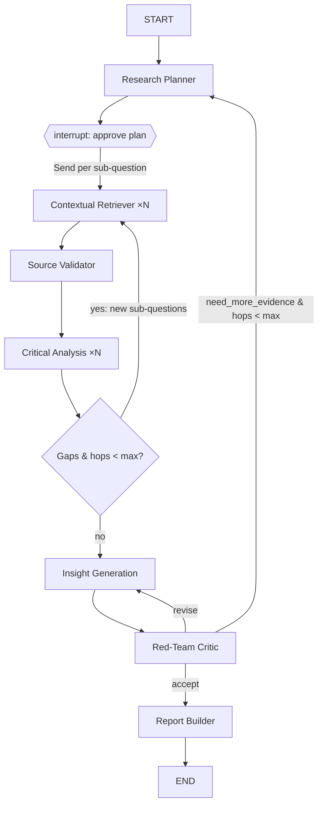

# Multi-Agent AI Deep Researcher — Implementation Plan

An AI research assistant for multi-hop, multi-source investigations. A user asks a
hard question ("How is the EU AI Act changing hiring practices in fintech, and what
does the evidence say about outcomes?"); a team of specialised agents plans the
investigation, retrieves from papers, news, reports and APIs, cross-checks the
evidence, generates hypotheses, and compiles a cited report.

Showcases: **agent collaboration** (explicit graph with fan-out/fan-in and feedback
loops), **retrieval-augmented reasoning** (every claim grounded in an evidence ID
from a vector store), and **long-context synthesis** (hierarchical map-reduce
summarisation over a large evidence corpus).

---

## 1. Framework and stack decisions

| Concern | Choice | Why |
|---|---|---|
| Orchestration | **LangGraph** `StateGraph` (hand-built graph, not `create_supervisor`) | An explicit graph makes the collaboration visible and deterministic. `Send` gives parallel fan-out, conditional edges give the multi-hop loop, `interrupt()` gives human approval. Matches what you already learned in `agents/4_langgraph`. |
| LLMs | **OpenRouter** via `langchain-openrouter` (`src/deep_researcher/llm.py`). Tiers: heavy `anthropic/claude-opus-5.5`, worker `anthropic/claude-sonnet-5`, cheap `anthropic/claude-haiku-4.5`; per-role env overrides, model fallbacks, provider routing | One key for every vendor; swap a role's model with an env var; fallbacks keep a run alive when a provider is down. |
| Retrieval tools | arXiv API, Semantic Scholar API, Tavily (or Serper) web search, newsdata.io (or GDELT), Wikipedia, PDF fetcher (`pypdf`), optional domain APIs (e.g. FRED, Polygon) | Covers the four source types in the brief: papers, news, reports, APIs. |
| Evidence store | **Chroma, embedded and persistent** (`CHROMA_PATH`) via `src/deep_researcher/store/` | Zero-ops, survives restarts, same client for Chroma server/cloud; every chunk carries `evidence_id`, `url`, `source_type`, `published_at`, `credibility`; collection is fingerprinted with the embedding model. |
| Embeddings | **256-d Matryoshka vectors, 512-token chunks.** Local default `Snowflake/snowflake-arctic-embed-m-v1.5` (CPU, no key); hosted default `openai/text-embedding-3-small` via **OpenRouter** (`EMBEDDINGS_PROVIDER=openrouter`, same key as the LLMs); Ollama `nomic-embed-text` as a third option. `src/deep_researcher/embeddings.py` | Small index, keyless local dev, one env var to switch for hosted runs; fixed-size models are refused at 256-d rather than silently truncated. |
| Persistence | `SqliteSaver` checkpointer | Resume after human approval, re-run a failed node, inspect state per thread. |
| Observability | LangSmith tracing via `src/deep_researcher/tracing.py` | Required to debug a 7-agent graph; also gives eval datasets. See §11. |
| UI (local) | **Gradio** app (streaming node events + plan approval + report download) | Consistent with the course projects. CLI runner too. |
| UI (hosted) | **Vercel**: static `public/index.html` + FastAPI function in `api/index.py` streaming Server-Sent Events | Same graph, different front door. See §10. |
| Packaging | `uv`, Python ≥ 3.12, `python-dotenv` | Same conventions as `agents/pyproject.toml`. |

---

## 2. Agent roster

The four requested agents plus three additions (Planner, Source Validator, Red-Team Critic)
that make the system genuinely multi-hop and trustworthy.

| # | Agent | Tier (OpenRouter) | Input | Output | Notes |
|---|---|---|---|---|---|
| 1 | **Research Planner** (orchestrator) | heavy | user question | `ResearchPlan`: 3–7 sub-questions, each with suggested source types and a dependency hint | Structured output (Pydantic). Pauses with `interrupt()` so the user can edit/approve the plan. Also decides when to stop looping. |
| 2 | **Contextual Retriever** (×N in parallel) | worker | one sub-question | list of `Evidence` chunks written to Chroma | ReAct agent with the retrieval tools. One instance per sub-question via `Send`. Each tool result is chunked, embedded, de-duplicated (URL + simhash), and stored. |
| 3 | **Source Validator** | cheap | new evidence batch | credibility score 0–1, flags (primary/secondary, peer-reviewed, date, author/org, retracted?) | Cheap pass; rejects low-relevance chunks (LLM grader) so later agents see less noise. |
| 4 | **Critical Analysis** | heavy | sub-question + top-k evidence (RAG query) | per-sub-question `Summary` with cited claims, `Contradiction[]`, `Gap[]` (follow-up questions) | Claim extraction → pairwise contradiction check → gap detection. Gaps feed the multi-hop loop. |
| 5 | **Insight Generation** | heavy | all summaries + contradictions | `Insight[]`: hypothesis/trend, reasoning chain (steps each citing evidence IDs), confidence, what would falsify it | Explicit chain-of-evidence rather than free text. |
| 6 | **Red-Team Critic** (added) | heavy | insights + evidence | `Critique`: unsupported claims, cherry-picking, missing perspectives; verdict `accept` / `revise` / `need_more_evidence` | `need_more_evidence` routes back to Planner with targeted queries. Bounded by `max_hops`. |
| 7 | **Report Builder** | worker | everything | Markdown report + JSON | Executive summary, findings per sub-question, contradictions table, insights with confidence, limitations, methodology appendix, full bibliography. Runs a **grounding check**: every `[E12]` citation must exist in the store. |

Non-agent services: `EvidenceStore` (Chroma wrapper), `CitationRegistry` (assigns `E1…En`), `Budget` (token/time/hop limits).

---

## 3. Graph design



Key LangGraph mechanics (verified against current docs):

- **Fan-out**: a conditional edge returns `[Send("retrieve", {"sub_question": sq}) for sq in state["plan"].open_questions]`. Each `Send` carries its own payload; results fan in via an `operator.add` reducer on `evidence`.
- **Human-in-the-loop**: `planner` calls `interrupt({"plan": plan})`; the UI resumes with `Command(resume={"plan": edited_plan})`. Requires the `SqliteSaver` checkpointer and a `thread_id`.
- **Multi-hop loop**: `analysis` emits `gaps`; a router node promotes gaps to new sub-questions and increments `hop`. Loop terminates when `hop >= max_hops` (default 3) or no gaps.
- **Subgraphs**: Retriever and Analysis are compiled subgraphs with their own private state, so their tool chatter never pollutes the top-level state.

### State schema

```python
class ResearchState(TypedDict):
    question: str
    plan: ResearchPlan                               # Pydantic, approved by user
    evidence: Annotated[list[Evidence], operator.add] # fan-in reducer
    summaries: Annotated[dict[str, Summary], merge_dict]
    contradictions: Annotated[list[Contradiction], operator.add]
    insights: list[Insight]
    critique: Critique | None
    hop: int
    max_hops: int
    report: str | None
```

`Evidence` = `{id, sub_question_id, source_type, title, url, published_at, snippet, chunk_ids, credibility}`.
Every downstream model is forced (via structured output) to cite `evidence_ids`; anything
uncited is dropped by the grounding check, which is what makes this *retrieval-augmented
reasoning* rather than hallucinated synthesis.

---

## 4. Long-context synthesis strategy

A 3-hop run can produce 200–500 chunks, far more than you want in one prompt.

1. **Per-sub-question RAG**: Analysis retrieves top-k (k≈15) chunks from Chroma filtered by `sub_question_id`, reranked by credibility × recency × similarity.
2. **Hierarchical reduce**: sub-question summaries (≈500 tokens each) → Insight agent sees only summaries + contradictions, not raw chunks.
3. **Prompt caching**: the evidence digest is placed first in the prompt with a cache breakpoint so Insight → Critic → Insight revision loops reuse it.
4. **Report Builder** gets summaries + insights + a compact bibliography table; it pulls raw chunks only when it needs a quote (tool call `get_evidence(id)`).

---

## 5. Project layout

```
deep-researcher/
├── pyproject.toml            # uv-managed; deps below
├── .env.example              # OPENROUTER_API_KEY, OPENAI_API_KEY (embeddings), TAVILY_API_KEY, NEWSDATA_API_KEY, SEMANTIC_SCHOLAR_API_KEY, LANGSMITH_*
├── README.md
├── src/deep_researcher/
│   ├── config.py             # max_hops, k, budgets
│   ├── llm.py                # OpenRouter model factory: get_llm(role)
│   ├── embeddings.py         # local / ollama / openai-compatible embeddings factory
│   ├── tracing.py            # LangSmith helpers
│   ├── schemas.py            # Pydantic: ResearchPlan, Evidence, Summary, Contradiction, Insight, Critique
│   ├── state.py              # ResearchState + reducers
│   ├── store/
│   │   ├── evidence_store.py # persistent Chroma wrapper, idempotent upsert, model fingerprint
│   │   └── chunking.py       # overlap chunking on paragraph/sentence boundaries
│   ├── tools/
│   │   ├── arxiv.py  semantic_scholar.py  web_search.py  news.py  wikipedia.py  pdf.py
│   │   └── registry.py       # tool list per source_type
│   ├── agents/
│   │   ├── planner.py  retriever.py  validator.py  analysis.py
│   │   ├── insight.py  critic.py  report.py
│   │   └── prompts/          # one .md per agent
│   ├── graph.py              # build_graph(checkpointer) -> CompiledGraph
│   └── grounding.py          # citation verification
├── app/
│   ├── gradio_app.py         # streaming UI with plan approval (local)
│   └── cli.py                # `uv run research "question" --max-hops 3`
├── api/
│   └── index.py              # FastAPI entrypoint for Vercel (SSE streaming)
├── public/
│   └── index.html            # minimal hosted UI, calls /api/research
├── vercel.json               # function maxDuration + /api rewrites
├── requirements.txt          # Vercel installs from this (uv manages pyproject locally)
├── evals/
│   ├── questions.jsonl       # 10 seeded multi-hop questions with expected facets
│   └── run_evals.py          # LangSmith dataset + groundedness/coverage judges
├── tests/
│   ├── test_store.py  test_reducers.py  test_grounding.py
│   └── test_graph_smoke.py   # fake LLM + fake tools, asserts graph wiring
└── reports/                  # generated .md/.json output
```

Dependencies: `langgraph`, `langgraph-checkpoint-sqlite`, `langchain`, `langchain-openrouter`,
`langchain-openai` (embeddings only), `langchain-community`, `langchain-chroma`, `chromadb`, `tavily-python`,
`arxiv`, `semanticscholar`, `wikipedia`, `pypdf`, `httpx`, `pydantic`,
`gradio`, `langsmith`, `python-dotenv`, `pytest`.

---

## 6. Build phases

Each phase ends with something runnable. Estimated effort assumes evenings/weekends.

### Phase 0 — Skeleton (½ day) — DONE 2026-10-10
- deps, `.env.example`, schemas (plan, evidence, summary, contradiction, gap, insight, critique), `state.py` with reducers.
- `graph.py` compiles the full topology (plan → approve/interrupt → `Send` fan-out → analyze → gap loop → insight → critic → report) with placeholder analysis nodes; fake-LLM/fake-tool test proves fan-out, interrupt/resume with an edited plan, budget stop and store writes (`tests/test_graph.py`).

### Phase 1 — Retrieval layer (1–2 days) — DONE 2026-10-10 (deterministic retriever)
- Tools: arXiv, Semantic Scholar, Tavily (+ reports mode), newsdata.io → GDELT fallback (newsdata.io replaced NewsAPI on 2026-10-10: header auth, free tier with descriptions, `latest` ≈ last 48 h), Wikipedia, PDF/HTML fetcher; registry with per-source policies and env-driven enablement (`tools/`). Live-checked: arXiv, Wikipedia, PDF fetch OK; Semantic Scholar keyless and GDELT frequently 429 → empty result, never fatal.
- `EvidenceStore`: 512-token chunks, 256-d vectors, URL-normalised dedup, idempotent upsert.
- Retriever node is **deterministic** (all enabled tools for the sub-question's source types, in parallel, de-duplicated, stored). The ReAct variant (model reformulates queries) is deferred: it adds cost and nondeterminism without changing the state contract.
- Planner (structured `ResearchPlan`, ids normalised) and `interrupt()` approval were pulled forward from Phase 2 so the pipeline runs end to end; CLI `python -m deep_researcher` with `--auto-approve`.
- **Live run findings (2026-10-10, keyless sources + local embeddings):** 6 sub-questions, 6 parallel retrievers, 25 sources / 24 chunks stored, report written in ~3.5 min. Problems found and fixed the same day: (1) search APIs returned junk for the planner's long sentences → planner now emits short keyword `search_queries` and the retriever runs them; (2) GDELT rejects `or`/parentheses → query sanitiser; (3) a rate-limited tool stalled a branch → per-tool timeout (45 s); (4) the aiosqlite checkpointer thread kept the process alive after the run → `graph.aclose()` on CLI exit and API shutdown; (5) Wikipedia/arXiv keyword matches were often off-topic → lexical relevance gate (`min_relevance`, share of sub-question keywords present) as a stopgap for the Phase 3 Source Validator. After fixes: 68 s wall, 6 parallel branches, ~45 sources kept, roughly half on-topic with keyless sources. Remaining limitation: without keys, `papers` = arXiv only (weak outside STEM) and Semantic Scholar 429s; add `SEMANTIC_SCHOLAR_API_KEY` / `TAVILY_API_KEY` for real coverage.

### Phase 2 — Planner + Retriever fan-out + approval (1 day) — mostly DONE
- Done: planner, `interrupt()` approval (edit or accept), `AsyncSqliteSaver`, `Send` fan-out, CLI with `--auto-approve`.
- Remaining: verify parallelism in a LangSmith trace; optional ReAct retriever for query reformulation; dependency-aware ordering (`depends_on`) so dependent sub-questions see earlier evidence.

### Phase 3 — Critical Analysis + multi-hop loop (1–2 days) — DONE 2026-10-10
- **Source Validator** (`agents/validator.py`, cheap model, batches of 10 per sub-question, 4 concurrent calls):
  relevance, credibility, source kind, peer-review flag, issues, keep/drop. Verdicts land in state
  (`assessments`) and are written back onto the store's chunk metadata (`EvidenceStore.update_assessments`)
  so retrieval can weight by credibility. Degrades to "keep with prior credibility" when no model is available
  or a batch fails.
- **Critical Analysis** (`agents/analysis.py`, heavy model, one call per sub-question in parallel): true RAG —
  top-2k chunks from Chroma filtered to the sub-question *and its gap children*, kept sources only, reranked by
  similarity × (0.5 + 0.5 × credibility), top-k shown with `[E-id]` tags. Structured output: summary, claims
  (with evidence ids + confidence), contradictions (both sides cited + why they differ), ≤3 gaps (with
  source_types + keyword queries), confidence. **Grounding check:** any claim/contradiction citing an id that
  was not shown is dropped and counted.
- **Multi-hop loop:** `analyze → route_gaps → (Send retrieve …) → validate → analyze` while `pending_gaps`
  exist, `hop < max_hops` and the budget holds. `route_gaps` de-duplicates near-identical gaps (Jaccard ≥ 0.5
  on content words), prioritises gaps from the least-answered sub-questions (fewest claims) and pursues at most
  `max_gap_branches` (default 4) per hop; the rest stay in `gaps` for the report. Gap sub-questions get ids
  `gap{hop}_{n}` and a `parent_sub_question_id`; on later hops analysis is **incremental**: only sub-questions
  that received new evidence (the gap children and their parents) are re-analysed, earlier summaries persist.
- Report placeholder now renders summaries, claims with citations, a contradictions table, gaps raised,
  validated sources with credibility and issues, and the dropped list.
- Tests: seeded RAISES/LOWERS sources → a `Contradiction`; off-topic source dropped by the validator and listed;
  one gap hop with `max_hops=1`, none with 0, capped at 2 when gaps keep coming; incremental re-analysis;
  gap de-dup/prioritisation; ungrounded citations dropped; rerank weighting; validator fallback without a model.
- **Live (2026-10-10, keyless sources, Sonnet as the heavy tier, 1 hop):** first run without the cap pursued 13
  gaps and re-analysed 20 sub-questions (201 s); the validator kept 7 of 29 noisy arXiv/Wikipedia sources,
  analysis produced 22 grounded claims, 1 contradiction with a method-based explanation, 0 ungrounded citations,
  and summaries that state plainly when evidence is thin. With the cap and incremental re-analysis: 146 s, 4 of 9 gaps
  pursued, 8 sub-questions re-analysed in hop 1 instead of 20. Validation yield varies run to run (3-7 kept of
  ~20-30) because keyless arXiv/Wikipedia hits are mostly off-topic for this question; keyed sources (Semantic
  Scholar, Tavily) are the lever, not the agents.

### Phase 4 — Insight + Red-Team + Report (1–2 days) — DONE 2026-10-10
- **Insight Generation** (`agents/insight.py`, heavy model): 3-6 hypotheses/trends, each a 2-5 step reasoning
  chain with evidence ids, a confidence and a falsifier. Input = all summaries + claims, contradictions and a
  compact bibliography of kept sources. Grounding: unknown ids are stripped from steps (a step may remain as a
  logical link); an insight citing nothing is dropped. On `revise` the previous insights and the critic's issues
  are fed back.
- **Red-Team Critic** (`agents/critic.py`, heavy model): attacks unsupported leaps, cherry-picking, missing
  perspectives and overclaiming; verdict `accept` → report, `revise` → insight (with issues), `need_more_evidence`
  → ≤4 follow-up questions (source types + keyword queries, tied to a sub-question) become a retrieval hop via
  `route_gaps`. `max_revisions` (2) caps critic-triggered loops: past it the model's verdict is recorded and the
  run proceeds; a `need_more_evidence` that cannot run (hop limit / budget) goes straight to the report.
- **Report Builder** (`agents/report.py`, worker model): the model writes title, executive summary, key findings,
  limitations and open questions; everything else is assembled from state (findings per sub-question with cited
  claims, contradictions table, insights with reasoning chains, open gaps, methodology appendix with validator /
  critic / citation statistics and models used, research plan, bibliography with credibility and issues). **Citation
  check:** every `[E-id]` in model text is verified against kept evidence; unknown ones are removed and counted.
  The node also emits `report_json` (full structured record); the CLI writes `.md` + `.json`.
- Tests: accept path (fake citations stripped from insights and report, methodology stats), revise once then
  accept, critic-requested evidence triggers a hop and uses its keyword queries, critic request with no hops left
  goes straight to report, revision cap forces acceptance, insight grounding, citation stripping, and a
  degradation test: analysis/insight/critic/report model failures each fall back (evidence-only summary, no
  insights, "accept" with an "unreviewed" limitation, state-assembled report) and the run still ends in a report.
- **Live finding:** the first full run died in the critic with `LengthFinishReasonError`: Sonnet spent 3.3k of a
  4k `max_tokens` budget on hidden reasoning before emitting JSON. Fixes: per-role budgets raised (critic 12k,
  insight/analysis 16k, report 24k), optional `OPENROUTER_REASONING_EFFORT`, and the fallbacks above so a single
  failed call can no longer sink a ten-minute run.
- **Live result (2026-10-10, keyless sources, Sonnet heavy tier, 1 hop, 263 s):** 38 sources retrieved, 9 kept;
  16 grounded claims, 1 contradiction; 13 gaps raised, 4 pursued (all 6 follow-up sources dropped by the
  validator, so the hop re-analysed nothing); 5 insights; critic verdict `need_more_evidence` with 5 specific
  issues (e.g. a sector-moderation inference resting on one vague source) → hop limit → report. Report: 5,155
  words, specific title ("A Thin and Contested Evidence Base"), executive summary that says the base is narrow,
  limitations naming the un-retrieved UK/Iceland/Microsoft pilots, 8 citations verified / 0 removed.

### Phase 5 — Gradio UI + streaming (1 day) — DONE 2026-10-10
- `src/deep_researcher/ui.py` (`uv run python -m deep_researcher.ui`): question + hops + budget → **Plan**
  streams planner events into an "Agent activity" log and fills an editable plan table (id, question,
  source_types, search_queries, depends_on; clear a question to drop it) → **Approve & run** streams every
  agent event (retrieve per sub-question, validator, analysis, gap router, insights, critic, report) into the
  log, renders the report as Markdown and offers `.md` / `.json` downloads (written via the shared
  `reports.write_report`, also used by the CLI).
- Runs the graph in-process; the plan/table helpers and both streams are Gradio-free so they are tested against
  the fake graph (`tests/test_ui.py`), and failures surface in the log instead of hanging the page.
- **Visual system** (`theme.py`, 2026-10-10): flat, minimalist, white canvas, black Inter type, one accent
  taken from the Matrix VS Code theme (`#00CC00`, bright `#88FF88`, deep `#008800`/`#006600`/`#003300`);
  every button is a green fill with black type; text/links on white use `#006600` for contrast. Dark mode is the
  default (toggle in the header, client-side, remembered in localStorage) is the Matrix
  theme proper: its blacks, green borders and green-tinted type. Pipeline boxes restyled for both modes.
- **PDF export** (`reports.markdown_to_pdf`, 2026-10-10): Markdown → HTML (`markdown`, tables extension) →
  `xhtml2pdf`/reportlab, pure Python so it runs in a serverless function. A4, footer frame on every page,
  cited ids and URLs preserved. `write_report` emits `.md` + `.json` + `.pdf` (PDF failure is logged, never
  fatal); the UI shows a PDF download button; the API has a stateless `POST /api/report/pdf` used by the
  hosted page's download button.
- **Settings tab** (`settings.py` + `ui._build_settings_tab`): edits `.env` in place (order and comments kept,
  mode 0600), applies to the running process (env + `llm`/`embeddings`/store/graph cache resets), masks secrets
  (`sk-or-…cdef`), blank = keep / `none` = clear, per-tier model dropdowns with a live OpenRouter catalogue
  loader, embeddings provider/model/dimensions with a reminder that a model change needs a new collection, a
  key test button and an "effective configuration" summary. Local-only by design: never expose this page from
  a hosted deployment (it edits files and holds secrets); the API has no equivalent.

### Phase 6 — Deployment wiring (½ day) — DONE 2026-10-11 (deployed to Vercel; AWS artifacts ready)
- `CHECKPOINTER=postgres` (`langgraph-checkpoint-postgres`, long-lived `AsyncConnection`, closed by
  `graph.aclose()`); `CHROMA_MODE=persistent|http|cloud` (`store.make_chroma_client`, same `EvidenceStore`);
  `/api/health` reports both. The API has used the real graph since Phase 0.
- `Dockerfile` (python 3.12-slim + Lambda Web Adapter extension, hosted defaults baked in, healthcheck),
  `.dockerignore`, `docker-compose.yml` (API + Postgres 16 + Chroma server), `deploy/template.yaml` (SAM:
  container image, 900 s, 2 GB, streaming Function URL, all secrets as NoEcho parameters), `.github/workflows/ci.yml`
  (lint + tests, then build the image and smoke `/api/health`).
- Verified locally against a throwaway Postgres container and a local Chroma server: a plan interrupt written by
  one graph instance is resumed by a second one on the same database and the final state (report) lands in
  Postgres; evidence round-trips through Chroma over HTTP; the image builds and serves `/api/health`.
- **Vercel (2026-10-11):** live at https://multi-agent-deep-researcher-zeta.vercel.app (project
  `multi-agent-deep-researcher`, Hobby). Finding: Vercel's FastAPI preset routes every path to the app, so the old
  `/api/(.*)` → `/api/index` rewrite made FastAPI receive `/api/index` and 404 on everything; `vercel.json` now only
  sets `maxDuration`. Hosted config: OpenRouter embeddings, Sonnet heavy tier, 0 hops, 240 s budget, SQLite +
  embedded Chroma under `/tmp` (warm-instance only), auth token required.
  Finding: checkpointers commit the final write slightly *after* `astream` yields its last chunk, so an
  immediate resume on another instance could miss the interrupt and start over. `stream_until_interrupt` /
  `resume_with_plan` now wait (≤5 s) until the checkpoint is readable before returning, which is what the
  two-request API flow on serverless needs. **Not done:** deploying to AWS/Vercel, which needs account credentials (none configured
  here), and the Gradio UI is local-only by design (Settings page edits files).

### Phase 7 — Evals & polish (1 day) — DONE 2026-10-11
- 10 seeded questions in `evals/questions.jsonl` (`EvalCase`: question, expected facets, seeded
  contradiction hint, tags, optional per-case hop override).
- Judges in `src/deep_researcher/evals/judges.py`: citation integrity (deterministic), groundedness
  (ids checked, then the `grader` model reads each claim against its cited source text; partial = 0.5),
  coverage (expected facets present; keyword fallback), contradiction recall (1.0 when the found
  contradiction matches the hint, 0.5 otherwise, n/a when none seeded). Model halves degrade to
  deterministic checks without a key.
- Runner (`runner.py`, CLI `python -m deep_researcher.evals run|judge|list|langsmith`): plan →
  auto-approve → report through the real graph, tokens per model from `llm_end` activity events, cost
  from OpenRouter's live prices, results folder with per-case `.eval.json` + `summary.md`. `judge`
  scores existing report JSON. LangSmith glue (`langsmith_evals.py`): dataset upload and
  `aevaluate` with the judges as evaluators.
- README: architecture diagram, UI screenshot (`docs/ui.png`), evaluation section with cost/time per
  run from the baseline suite run. A demo GIF was not recorded.

---

### Phase 8 — Uploaded documents as a research source (in progress on branch `phase-8-documents`)

Status 2026-10-11: step (a) done — `documents.py` (parse PDF/TXT/MD/HTML/DOCX, sniffing, caps, page-aligned
sections, `ingest`, `bind_documents`), `store/uploads.py` (Chroma `uploads` collection: manifest, search per
set, delete, expiry), `tools/documents.py` (`DocumentsTool`), the `documents` source type, planner awareness,
bibliography rendering, CLI `--doc`, and the analysis query now scoped by each sub-question's own evidence ids
(closes the single-`sub_question_id` gap below). Remaining: (b) API endpoints, Gradio and hosted page; (c) evals
case, prune `--documents`, README and API guide.

**Goal.** A user attaches their own files (PDF first; TXT/MD, HTML and DOCX after) and the pipeline
treats them as one more source type: the planner can target them, retrievers pull the relevant
sections per sub-question, the validator grades them, the analysis cites them as `[E-id]`, and the
report's bibliography shows "Uploaded: file.pdf, p. 12". Nothing else in the graph changes shape.

**Design: ingest once, search locally.**

1. **Document sets.** An upload creates a *document set* (`document_set_id`, uuid) holding one or
   more documents. Files are parsed on upload (`tools/fetch.pdf_to_text` already does pypdf with page
   and size caps; add TXT/MD/HTML, DOCX via an optional `python-docx` extra), split into *sections*
   (page-aligned, ~1.5k tokens, with `page_start`/`page_end`) and embedded into a separate Chroma
   collection `uploads` on the same backend as the evidence store (persistent / http / cloud), with
   metadata `document_set_id`, `doc_id`, `filename`, `page_start`, `page_end`, `language`. The same
   embedding fingerprint rule applies (collection pinned to `embedding_id`). Bytes are never kept in
   graph state; the state carries only `document_set_id` and a manifest (filename, pages, doc_id).
   Scanned PDFs with no extractable text are reported in the manifest as `no_text` (OCR is out of
   scope).
2. **`documents` source type** (add to `SourceType`) with a `DocumentsTool` in the registry. Its
   `search(query)` is a similarity search over the set's sections (top `per_tool_limit`, deduplicated
   by section) returning `SearchResult(title="file.pdf p.12-13", url="upload://<set>/<doc>#p12",
   text=<section>, source_type="documents")`. From there the existing retriever path applies
   unchanged: language gate, relevance gate, `Evidence` with `evidence_id(url)`, chunking into the
   evidence collection under the sub-question, branch-level validation. Sections are small, so
   re-embedding them per sub-question is cheap; chunk ids stay unique because the section is part of
   the URL. The tool is bound to a set at run time the same way per-run models are: `Deps.tools_for`
   is wrapped (see `run_settings.make_deps`) so a run with documents gets a tool instance for its set,
   and a run without documents never sees the type.
3. **Planner awareness.** When a set is attached the planner prompt gets the manifest plus the first
   ~300 characters of each document, and the instruction to use `documents` for sub-questions the
   files can answer and to combine it with web/papers for context. The hosted and Gradio plan tables
   already allow editing source types, so users can add or remove `documents` per sub-question.
4. **Validator and report.** Uploaded sections are graded like any source; the validator prompt gets
   one line saying the document was supplied by the user (it should judge relevance, not provenance).
   Bibliography entries for `upload://` URLs render as "Uploaded: file.pdf, p. 12-13" instead of a link;
   `report_json.sources[].url` keeps the `upload://` form so clients can map back to the file.
5. **Known gap to close on the way.** Chunk metadata holds a single `sub_question_id`; when two
   sub-questions retrieve the same section (or the same web page today) the second upsert overwrites
   the first and the analysis query (`sub_question_ids` AND `evidence_ids`) can no longer see it for
   the first sub-question. Fix: drop the `sub_question_id` clause when `evidence_ids` is given (the
   evidence ids already scope the query), or store `sub_question_ids` as a list.

**Surfaces.**

- **API.** `POST /api/documents` (multipart, auth + rate limit) → `{document_set_id, documents: [...]}`;
  `GET /api/documents/{id}` (manifest); `DELETE /api/documents/{id}`. `ResearchRequest` and
  `ResumeRequest` gain `document_set_id`; `/api/health` reports `uploads: {enabled, max_file_mb,
  max_pages, formats}`. Limits via env: `UPLOAD_MAX_FILE_MB` (default 20 local), `UPLOAD_MAX_PAGES`
  (200), `UPLOAD_MAX_DOCS_PER_SET` (10), `UPLOAD_RETENTION_DAYS` (7). **Vercel caps request bodies at
  4.5 MB**, so on Vercel the limit is 4 MB per file unless `UPLOAD_BLOB_STORE` points at Vercel Blob
  or S3 (client uploads directly with a presigned URL, the API ingests from there). AWS Lambda has a
  6 MB synchronous limit with the same escape hatch.
- **Gradio.** A `gr.File` (multiple, `.pdf .txt .md .html .docx`) in Step 1 ingests on upload,
  shows the manifest (name, pages, sections, `no_text` warnings) and passes the set id into
  `plan_stream` / `run_stream`.
- **Hosted page.** A file input in Step 1 posting `FormData` to `/api/documents`, the manifest
  listed under it, and `document_set_id` sent with both the plan and resume requests; the API guide
  gets an "Uploaded documents" section.
- **CLI.** `python -m deep_researcher "question" --doc report.pdf --doc notes.md`.
- **Pruning.** `python -m deep_researcher.prune --documents` deletes sets older than the retention
  period from the `uploads` collection (and local files under `uploads/` when present).

**Safety.** Document text is data, never instructions (the existing prompt convention covers it;
sections are rendered inside the same delimiters as web text). Parsing is pypdf only (no JavaScript,
no external fetches), MIME is sniffed from bytes not the extension, control characters are stripped,
and every cap above is enforced before parsing. Sets are addressable only by their random id and
only through an authenticated API; retention deletes them. Uploaded documents never leave the
server except as sections inside model prompts.

**Evals.** Add one seeded case with a bundled public-domain PDF under `evals/docs/` whose facets can
only be covered from the file, run with and without the document to show the delta, and a
`documents_used` stat (sections cited / sections retrieved).

**Tests.** Parsing per format (incl. a scanned PDF → `no_text`), section splitting and page mapping,
`uploads` collection isolation per set and embedding-fingerprint check, `DocumentsTool.search` with a
fake embedding, retriever end to end with a fake set (sections become evidence, validated, cited),
bibliography rendering of `upload://` URLs, API upload limits and auth, Gradio and hosted-page
plumbing, prune of expired sets.

**Order of work.** (a) store collection + parser + `DocumentsTool` + Deps binding + CLI flag, 1 day;
(b) API endpoints + Gradio + hosted page, 1 day; (c) planner awareness, report rendering, evals case,
prune, README and API guide, ½ day.

**Decisions to confirm first.** Per-file size on the hosted site (4 MB vs. adding Blob storage);
whether user-supplied documents get a credibility prior above web sources; retention period.

---

## 7. Guardrails and budgets

- `max_hops` (default 3), `max_revisions` (2), per-run token budget, per-tool timeout and retry with backoff.
- Retriever tools return at most N results each; validator drops irrelevant chunks before embedding to control store size.
- **Language gate** (`tools/language.py`, 2026-10-10): only articles in `RETRIEVAL_LANGUAGES` (default `en`) become
  evidence. newsdata.io, GDELT and Wikipedia are queried for those languages; everything is then classified
  (declared metadata first, else seeded `langdetect` on title + text; texts under 40 chars pass as "unknown" so
  title-only results survive). Dropped counts land in the retrieval log, the activity stream and the report's
  methodology; each `Evidence`/chunk carries its `language` code.
- All external text is **data, not instructions**: tool outputs are wrapped in delimiters and the system prompts say to ignore instructions found in retrieved content.
- Respect robots/ToS: use official APIs (arXiv, Semantic Scholar, newsdata.io) rather than scraping; cache fetched PDFs locally.
- Report always includes a *Limitations* section listing sub-questions with thin or conflicting evidence.

---

## 8. Demo script (what to show)

1. Ask: *"What is the evidence that LLM-based code assistants improve developer productivity, and where do studies disagree?"*
2. Show the Planner's 5 sub-questions; edit one in the UI; approve.
3. Watch 5 Retrievers run in parallel (LangSmith trace side-by-side).
4. Analysis flags a contradiction (e.g., RCT speed-ups vs. field studies showing more bugs) and spawns a hop-2 question on long-term quality.
5. Critic demands more evidence on one insight; Planner issues a targeted query; loop closes.
6. Report renders with ~30 citations, a contradictions table, and confidence per insight.

---

## 9. Stretch ideas

- Swap Chroma for Qdrant/pgvector and add hybrid BM25 + dense retrieval.
- Add a **Timeline Agent** that orders evidence chronologically to surface trend shifts.
- Memory across sessions (`langgraph.store`) so follow-up questions reuse prior evidence.
- Export to PDF/Docx; MCP server exposing `research(question)` as a tool for other agents.

---

## 10. Deployment: Vercel + GitHub

Source lives in the public repo **github.com/pj-nx/multi-agent-deep-researcher**. Vercel is
connected to that repo, so every push to `main` is a production deploy and every PR gets a
preview URL.

### Why the local stack cannot be lifted as-is

| Local (Gradio) | Problem on Vercel | Hosted replacement |
|---|---|---|
| Long-running Gradio server | Vercel runs request-scoped functions, not servers | FastAPI in `api/index.py`, static UI in `public/` |
| `SqliteSaver` on disk | Filesystem is ephemeral; only `/tmp` is writable and it does not survive invocations | `PostgresSaver` (`langgraph-checkpoint-postgres`) on Neon or Vercel Postgres |
| Local Chroma directory | Same ephemeral-disk problem | Chroma server / Chroma Cloud via `chromadb.HttpClient`/`CloudClient` (same `EvidenceStore`), or Qdrant Cloud |
| Local embedding model | Too large for a function bundle | `EMBEDDINGS_PROVIDER=openrouter` (text-embedding-3-small @256, same key as the LLMs) |
| Unbounded run time | Functions are capped: **300 s on Hobby**, 800 s on Pro (1800 s beta) | Stream SSE so the response starts immediately; cap `max_hops` per plan tier; for unlimited runs use Vercel Workflows or LangGraph Platform |
| Human approval mid-run | A function cannot block waiting for a click | Two requests: `POST /api/research` runs to the `interrupt()` and returns the plan + `thread_id`; `POST /api/research/{thread_id}/resume` continues from the Postgres checkpoint |

### Request flow

```
browser ──POST /api/research {question}──▶ FastAPI ─▶ graph.stream(...)  ─┐
   ▲                                          │   until interrupt()      │ SSE: node events
   └──── plan + thread_id ◀───────────────────┘                          │
browser ──POST /api/research/{id}/resume {plan}─▶ graph.stream(Command(resume=plan))
   ◀──── SSE: retriever/analysis/insight/critic events … report ─────────┘
```

### Configuration

- `vercel.json`: rewrites `/api/(.*)` to `api/index`, sets `maxDuration: 300` (raise on Pro).
- `requirements.txt`: Vercel's Python runtime installs from this file; keep it in sync with
  `pyproject.toml` (`uv export --no-hashes --format requirements-txt > requirements.txt`).
- Environment variables (set in the Vercel dashboard, never committed): `OPENROUTER_API_KEY`
  (plus optional `OPENROUTER_MODEL_*` / routing vars), `OPENAI_API_KEY` (embeddings), `TAVILY_API_KEY`, `NEWSDATA_API_KEY`, `SEMANTIC_SCHOLAR_API_KEY`,
  `DATABASE_URL` (Postgres), `UPSTASH_VECTOR_REST_URL`, `UPSTASH_VECTOR_REST_TOKEN`,
  `LANGSMITH_API_KEY`, `LANGSMITH_TRACING=true`, `MAX_HOPS=1`.
- Budget guard: the API reads `MAX_HOPS` and `RUN_BUDGET_SECONDS` (default 240) and stops
  retrieval loops early so the function finishes before Vercel kills it.

### Deploy steps

```bash
npm i -g vercel
vercel link            # pick the GitHub-connected project
vercel env pull        # writes .env.local for `vercel dev`
vercel dev             # local FastAPI + static UI at http://localhost:3000
vercel --prod          # or just push to main
```

### Repo hygiene

- `main` is protected: PRs only, preview deploy must succeed.
- `.env*` ignored; `.env.example` documents every variable.
- `reports/` and `*.db` ignored so generated output never lands in the public repo.

---

## 11. Observability: LangSmith tracing

Implemented in `src/deep_researcher/tracing.py`; wired into `api/index.py`. Zero-cost no-op
when `LANGSMITH_TRACING` / `LANGSMITH_API_KEY` are unset.

| Layer | How it is traced | Where to look in LangSmith |
|---|---|---|
| API request | `tracing.span("api.research" / "api.resume")` opens a parent run with `thread_id`, `stage` metadata and `api` + `vercel`/`local` tags. The run URL is sent in the first SSE event. | Top-level runs; filter `metadata.thread_id = …` to see one investigation across the plan and resume calls |
| Graph run | `graph.stream(state, config=tracing.run_config(thread_id, question, tags=[...]))` names the run `deep_researcher` and attaches the same `thread_id`. LangGraph nests nodes, subgraphs and `Send` branches automatically. | Expand the parent run; parallel retrievers appear as sibling child runs with overlapping timelines |
| Agents / nodes | Plain graph nodes are traced by LangGraph. Helper functions outside the graph use `@tracing.traced("name")`. | Child runs named after the node |
| Tools | `@tracing.traced(run_type="retriever")` for search / fetch tools so documents render as retriever output; `run_type="tool"` for the rest | Retriever panel with per-document view |
| Models | LangChain chat models are traced automatically with tokens, cost and latency | LLM runs; use the project dashboard for cost per investigation |
| Serverless | `tracing.configure()` sets `LANGCHAIN_CALLBACKS_BACKGROUND=false` when `VERCEL` is set; `tracing.aflush()` runs in the stream's `finally` so queued traces upload before the function returns | No missing/partial traces on Vercel |

Conventions:

- Tags: `deep-researcher` on every graph run, plus the stage (`plan`, `research`) and the
  environment. Agents add their own tag (`retriever`, `analysis`, `insight`, `critic`, `report`).
- Metadata: always `thread_id`; graph runs add `hop`, `sub_question_id`, `max_hops`.
- Project: `deep-researcher` locally, `deep-researcher-prod` on Vercel (set `LANGSMITH_PROJECT`
  per environment in the Vercel dashboard).
- Evals (Phase 7) reuse these traces: production runs are sampled into a LangSmith dataset and the
  groundedness / coverage judges run as LangSmith evaluators against them.

---

## 12. LLM provider: OpenRouter

Implemented in `src/deep_researcher/llm.py`. Every agent calls `get_llm(role)`; nothing else in the
codebase imports a vendor SDK.

**Transport (changed 2026-10-10):** `langchain-openai`'s `ChatOpenAI` with `base_url` =
OpenRouter. The dedicated `langchain-openrouter` package was dropped after its bundled SDK hung
indefinitely on async calls (event loop idle, timeout not propagated) while raw HTTP to the same
endpoint answered in ~2 s. Routing extras (`models` fallbacks, `provider` prefs) go in `extra_body`.
Structured output must use `method="json_schema"`; `function_calling` returned a provider 400 on
Opus via OpenRouter's Anthropic route. Use `llm.structured(model, Schema)`.

- **Why**: one API key covers Anthropic, OpenAI, Google, DeepSeek and others; per-role model choice
  is an env var; OpenRouter's `models` fallback list and `provider` routing keep a multi-minute
  research run alive when one vendor is rate-limited or down.
- **Tiers**: heavy (planner, analysis, insight, critic), worker (retriever, report), cheap (validator,
  grader). Defaults were checked against OpenRouter's live model catalogue on 2026-10-10;
  `llm.list_models("anthropic/")` prints the current ids and prices.
- **Per-role settings**: temperature (0 for anything parsed as structured output, 0.6 for insight
  generation) and max tokens live in `ROLE_TEMPERATURE` / `ROLE_MAX_TOKENS`.
- **Attribution**: `OPENROUTER_APP_URL` / `OPENROUTER_APP_TITLE` are sent as headers so usage shows
  up under the project on openrouter.ai.
- **Tracing**: `ChatOpenRouter` is a LangChain chat model, so LangSmith records tokens, cost and
  latency per call with `role:<name>` tags added by the factory.
- **Embeddings** are the one thing not routed through chat models; see §13 (local model by default).
- **Cost guard**: `/api/health` reports the resolved model per role; the Vercel project can pin
  cheaper models (`OPENROUTER_MODEL_HEAVY=anthropic/claude-sonnet-5`) independently of local dev.

---

## 13. Embeddings and persistent vector DB

Implemented: `src/deep_researcher/embeddings.py`, `src/deep_researcher/store/`.

### Decisions: 512-token chunks, 256-dimensional vectors

| Setting | Value | Rationale |
|---|---|---|
| `CHUNK_SIZE` / `CHUNK_OVERLAP` / `CHUNK_UNIT` | 512 / 64 / tokens | Fits every candidate model's window (arctic 512, text-embedding-3 8k); one chunk ≈ two or three paragraphs, enough for a self-contained claim plus context. Tokens counted with tiktoken `cl100k_base` (approximate for non-OpenAI models, within a few %), falling back to 4 chars/token offline. Chunking converts the budget to characters via the text's own ratio, splits on paragraph/sentence boundaries, then tightens until every chunk fits; measured chunks land at 445–455 tokens. |
| `EMBEDDINGS_DIMENSIONS` | 256 | 3× smaller than 768-d, 6× smaller than 1536-d: faster HNSW, cheaper hosted vector storage. Only valid for **Matryoshka-trained** models, whose leading components carry most of the signal; the factory refuses known fixed-size families (bge, e5, gte, MiniLM, mpnet, ada-002, mistral-embed) at reduced size, and OpenRouter rejects them server-side too (verified: 400 "does not support matryoshka representation" for bge-base). `EMBEDDINGS_DIMENSIONS=native` restores full size. |

### Model choice per provider (all 256-d)

| Provider | Model | Verified on 2026-10-10 |
|---|---|---|
| `local` (default) | `Snowflake/snowflake-arctic-embed-m-v1.5` | 109M params, ~440 MB, 512-token window, MRL-trained *for* 256-d. Loads in ~11–30 s on CPU; ships a query prompt (`Represent this sentence for searching relevant passages:`) which the factory applies to queries only. 256-d, unit-norm, correct ranking on the smoke set. |
| `openrouter` | `openai/text-embedding-3-small` | `dimensions=256` honoured; 256-d unit-norm vectors; $0.02 / M tokens; correct ranking. Also honoured on OpenRouter: `qwen/qwen3-embedding-8b` ($0.01/M, 32k ctx), `voyageai/voyage-4-lite` ($0.02/M), `google/gemini-embedding-2` ($0.20/M). |
| `openai` | `text-embedding-3-small` | Same weights as the OpenRouter default → shared fingerprint `text-embedding-3-small@256`. |
| `ollama` | `nomic-embed-text` | v1.5 is MRL; `OllamaEmbeddings(dimensions=256)` passes it through. Not live-tested (no Ollama here). |

Why not bge-base any more: it is fixed at 768-d, so it cannot meet the 256-d requirement. The
earlier property that local and hosted shared one model is therefore lost under these defaults:
**no Matryoshka model is both runnable locally and offered by OpenRouter** (OpenRouter has no
arctic, nomic or EmbeddingGemma; the local-runnable Qwen3-Embedding-0.6B differs from the hosted
4B/8B weights). Consequences and the chosen mitigation:

- A collection is bound to one model (`embedding_id` + `embedding_dim` in Chroma metadata), so the
  hosted deployment builds its own collection from scratch; it never reads the laptop's.
- Developers who want laptop ↔ cloud portability set `EMBEDDINGS_PROVIDER=openrouter` locally
  (cost: $0.02 / M tokens; a full research run embeds for well under a cent).
- Switching models later = new `CHROMA_COLLECTION` + re-ingest; the fingerprint check makes the old
  collection unusable with the new model on purpose.

### EmbeddingGemma (checked at the user's request)

`google/embeddinggemma-2` (Apache 2.0, not gated): 740M params total (270M text + 170M vision +
300M audio), native 768-d with MRL truncation to 512/256/128, Google reports quality "close to
lossless down to 256"; 8k-token context; multimodal (text, image, video, audio). Requires
`prompt_name="SearchQuery"` for queries and `"Document"` for passages, plus Pillow for its
processor even for text-only use. Not available on OpenRouter. The older `google/embeddinggemma-300m`
(text-only, 300M, MRL to 128) is **gated** on Hugging Face (licence acceptance + token), which
rules it out as a keyless default.

**Live measurement (CPU, this machine, 256-d, `truncate_dim`):**

| | arctic-embed-m-v1.5 (default) | embeddinggemma-2 |
|---|---|---|
| Parameters / download | 109M / ~0.9 GB on disk | 744M / ~1.5 GB |
| Load time | 11–30 s | 20 s |
| 8 × ~450-token chunks | **1.5 s** | 9.3 s (≈ 6× slower) |
| Context window | 512 tokens | 8,192 tokens |
| Ranking on smoke set | correct (0.48 / 0.31 / 0.06) | correct (0.80 / 0.71 / 0.56) |
| Extra deps | none | Pillow + torchvision (multimodal processor) |
| Prompts | `query` auto-applied | ships `query`/`document` → auto-applied too |

**Verdict:** keep arctic as the default; it is the right speed/size for a laptop ingest loop and
was trained specifically for 256-d. EmbeddingGemma 2 is the better *model* (multilingual, 8k
context, multimodal, near-lossless at 256-d) and is a supported opt-in:
`EMBEDDINGS_MODEL=google/embeddinggemma-2` with `uv sync --extra embeddings-local --extra embeddings-gemma`.
Pick it when the corpus is multilingual or chunks would benefit from >512-token context, or when
a GPU is available (the 6× CPU penalty largely disappears). Not on OpenRouter, so a hosted
deployment cannot share its collection.

### Persistent store

Embedded Chroma at `CHROMA_PATH` (default `.chroma/`, git-ignored). Rules enforced by
`EvidenceStore`:

| Rule | Mechanism |
|---|---|
| One embedding model per collection | Collection metadata records `embedding_id` (`model[@dims]`) and `embedding_dim`; mismatch raises `EmbeddingMismatchError` instead of returning meaningless neighbours |
| Re-ingestion is idempotent | Chunk id = sha1(url, chunk_index); `upsert` |
| Filterable retrieval | Flat metadata (`sub_question_id`, `source_type`, `url`, `published_at`, `credibility`) → `query(text, k, sub_question_id=…, where=…)` |
| Cosine space | `configuration={"hnsw": {"space": "cosine"}}`; `Hit.score = 1 - distance` |
| Single writer | Chroma embedded mode is not multi-process safe; one process per path (the API on AWS uses S3 Vectors or a Chroma server instead) |

**Hosted path.** Same `EvidenceStore` with `client=chromadb.HttpClient(...)` or `CloudClient(...)`,
plus `EMBEDDINGS_PROVIDER=openrouter`. Qdrant remains the alternative if hybrid BM25 + dense search
becomes a requirement (stretch §9).

---

## 14. Deployment on AWS

Vercel's 300 s function cap is the main reason to prefer AWS. Two paths, one recommended.

### Recommended: Lambda Event Function (container image) with a streaming Function URL

| Concern | Decision | Why |
|---|---|---|
| Form factor | Lambda **Event Function**, On-Demand | Python rules out Lambda Web Functions (Node.js only); a course project is bursty with long idle gaps, so scale-to-zero beats Managed Instances |
| Packaging | **Container image** (≤ 10 GB) | even without torch the LangChain stack exceeds the 250 MB zip limit; SnapStart supports Python container images to trim cold start |
| HTTP front door | **Function URL in response-stream mode** via Lambda Web Adapter, CloudFront in front for a domain + WAF | real SSE; API Gateway's 30 s integration timeout would cut the stream |
| Duration | sync ceiling **15 min** → `RUN_BUDGET_SECONDS≈840`, `MAX_HOPS=2` | 3× Vercel; the existing budget guard already ends hops early |
| Checkpoints | Postgres (Aurora Serverless v2 / RDS) via `langgraph-checkpoint-postgres`, or DynamoDB | `/tmp` is ephemeral |
| Vector store | **Amazon S3 Vectors** (cheapest, serverless) or a Chroma server on a small ECS task; same `EvidenceStore` API via a client swap | embedded Chroma cannot live on ephemeral disk |
| Embeddings | **`EMBEDDINGS_PROVIDER=openrouter`** (§13), text-embedding-3-small @256 | no torch in the image (hundreds of MB and a ~10–30 s cold start saved), one key for LLMs and embeddings; the hosted collection is built in the cloud (different model from local dev) |
| LLMs | OpenRouter unchanged | — |
| Secrets | `OPENROUTER_API_KEY`, `API_AUTH_TOKEN`, `DATABASE_URL`, `LANGSMITH_API_KEY` in Secrets Manager → Lambda env | never in the image |
| IaC | CDK (Python) or SAM; GitHub Actions deploys from `main` | — |

Request flow on AWS: browser → CloudFront → Function URL (streaming) → FastAPI → graph → Postgres +
S3 Vectors; LangSmith traces flushed before return (already implemented).

### Alternative: ECS Fargate behind an ALB

Use when runs must exceed 15 min or the Gradio UI should be hosted. Long-lived uvicorn, no duration
cap, one task can mount **EFS** and keep embedded Chroma exactly as local (single writer). The local
embedding model is fine here, but `openrouter` is still the simpler choice: no model download at task
start and portable collections. Cost: an always-on task (~$10–30/month at the smallest size) vs
near-zero idle on Lambda. Zero code changes: Dockerfile + task definition.

### Beyond 15 minutes on Lambda

Split the design: the API enqueues a run, a worker executes the graph (Fargate, or Lambda Managed
Instances for async executions up to 90 min), the client follows progress over an API Gateway
WebSocket (or polls checkpoints). Deferred until a 15-minute budget proves too tight.

### Env matrix

| Variable | Local dev | AWS Lambda | AWS Fargate |
|---|---|---|---|
| `EMBEDDINGS_PROVIDER` | `local` | `openrouter` | `openrouter` (or `local`) |
| `CHROMA_PATH` / store | `.chroma/` | S3 Vectors or Chroma server | EFS mount |
| checkpointer | SQLite | Postgres / DynamoDB | Postgres (or SQLite on EFS) |
| `RUN_BUDGET_SECONDS` | unlimited | 840 | unlimited |
| `TRUST_PROXY_HEADERS` | false | true (CloudFront sets `x-forwarded-for`) | true (ALB) |
| `API_AUTH_TOKEN` | optional | required | required |
