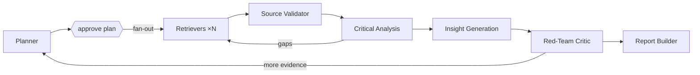

# Multi-Agent Deep Researcher

An AI research assistant for multi-hop, multi-source investigations, built on
[LangGraph](https://docs.langchain.com/oss/python/langgraph). A planner decomposes a hard
question, parallel retriever agents pull from papers, news, reports and APIs, a critical-analysis
agent cross-checks the evidence and flags contradictions, an insight agent proposes hypotheses
with reasoning chains, a red-team critic challenges them, and a report builder compiles a fully
cited report.

Showcases **agent collaboration**, **retrieval-augmented reasoning** (every claim cites a stored
evidence ID that is verified before the report ships) and **long-context synthesis**.

**Status:** planning + deployable skeleton. See [PLAN.md](PLAN.md) for the full design, agent
roster, graph, phases and Vercel architecture.

## Architecture



## Quick start (local)

```bash
uv sync --extra dev
cp .env.example .env            # fill in keys
uv run uvicorn api.index:app --reload
# open http://localhost:8000/api/health
```

The Gradio UI (`app/gradio_app.py`) and the LangGraph graph (`src/deep_researcher/`) land in
Phases 1–5 of the plan.

## Deploy to Vercel

The repo is Vercel-ready: `api/index.py` is a FastAPI function (Server-Sent Events streaming),
`public/index.html` is the hosted UI, and `vercel.json` sets `maxDuration` and `/api` rewrites.

```bash
npm i -g vercel
vercel link
vercel env add ANTHROPIC_API_KEY   # repeat for the variables in .env.example
vercel --prod
```

Or import the GitHub repo in the Vercel dashboard; pushes to `main` deploy automatically.

**Constraints that shape the hosted design** (details in PLAN.md §10):

- Functions are capped at 300 s on Hobby (800 s on Pro), so the API streams events immediately and
  honours `MAX_HOPS` / `RUN_BUDGET_SECONDS`.
- The filesystem is ephemeral, so hosted runs use a Postgres checkpointer and a hosted vector
  store instead of SQLite + local Chroma.
- Human plan approval is split into two requests: `POST /api/research` returns the plan and a
  `thread_id`; `POST /api/research/{thread_id}/resume` continues from the checkpoint.

## API

| Method | Path | Purpose |
|---|---|---|
| GET | `/api/health` | liveness + whether the graph is wired |
| POST | `/api/research` | `{question, max_hops?}` → SSE stream until plan approval |
| POST | `/api/research/{thread_id}/resume` | `{plan}` → SSE stream to final report |

## License

No license has been chosen yet; all rights reserved until one is added.
