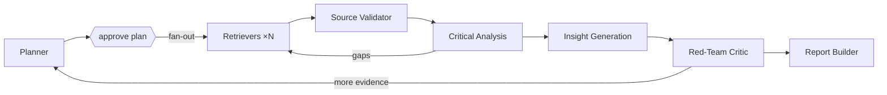

# Multi-Agent Deep Researcher

An AI research assistant for multi-hop, multi-source investigations, built on
[LangGraph](https://docs.langchain.com/oss/python/langgraph). A planner decomposes a hard
question, parallel retriever agents pull from papers, news, reports and APIs, a critical-analysis
agent cross-checks the evidence and flags contradictions, an insight agent proposes hypotheses
with reasoning chains, a red-team critic challenges them, and a report builder compiles a fully
cited report.

Showcases **agent collaboration**, **retrieval-augmented reasoning** (every claim cites a stored
evidence ID that is verified before the report ships) and **long-context synthesis**.

**Status:** planning + deployable skeleton. See [PLAN.md](PLAN.md) for the full design, agent
roster, graph, phases and Vercel architecture.

## Architecture



## Quick start (local)

```bash
uv sync --extra dev
cp .env.example .env            # fill in keys
uv run uvicorn api.index:app --reload
# open http://localhost:8000/api/health
```

The Gradio UI (`app/gradio_app.py`) and the LangGraph graph (`src/deep_researcher/`) land in
Phases 1–5 of the plan.

## Deploy to Vercel

The repo is Vercel-ready: `api/index.py` is a FastAPI function (Server-Sent Events streaming),
`public/index.html` is the hosted UI, and `vercel.json` sets `maxDuration` and `/api` rewrites.

```bash
npm i -g vercel
vercel link
vercel env add ANTHROPIC_API_KEY   # repeat for the variables in .env.example
vercel --prod
```

Or import the GitHub repo in the Vercel dashboard; pushes to `main` deploy automatically.

**Constraints that shape the hosted design** (details in PLAN.md §10):

- Functions are capped at 300 s on Hobby (800 s on Pro), so the API streams events immediately and
  honours `MAX_HOPS` / `RUN_BUDGET_SECONDS`.
- The filesystem is ephemeral, so hosted runs use a Postgres checkpointer and a hosted vector
  store instead of SQLite + local Chroma.
- Human plan approval is split into two requests: `POST /api/research` returns the plan and a
  `thread_id`; `POST /api/research/{thread_id}/resume` continues from the checkpoint.

## LLM provider: OpenRouter

All agents get their chat model from [`src/deep_researcher/llm.py`](src/deep_researcher/llm.py),
which routes through [OpenRouter](https://openrouter.ai). One key, any vendor, per-role model
choice, automatic fallbacks.

```bash
OPENROUTER_API_KEY=sk-or-...
```

| Tier | Roles | Default model | Override |
|---|---|---|---|
| heavy | planner, analysis, insight, critic | `anthropic/claude-opus-5.5` | `OPENROUTER_MODEL_HEAVY` |
| worker | retriever, report | `anthropic/claude-sonnet-5` | `OPENROUTER_MODEL_WORKER` |
| cheap | validator, grader | `anthropic/claude-haiku-4.5` | `OPENROUTER_MODEL_CHEAP` |

Any single role can be pinned with `OPENROUTER_MODEL_<ROLE>`, e.g.
`OPENROUTER_MODEL_INSIGHT=openai/gpt-5.1`. `OPENROUTER_FALLBACK_MODELS` lists backups tried in
order when the primary is unavailable, and `OPENROUTER_PROVIDER_ORDER` / `OPENROUTER_ZDR` /
`OPENROUTER_SORT` control provider routing. `/api/health` shows the resolved model per role.

```python
from deep_researcher.llm import get_llm
get_llm("planner").invoke("...")           # ChatOpenRouter, traced by LangSmith automatically
```

## Tracing with LangSmith

Set three variables (locally in `.env`, on Vercel in the project settings) and every request
becomes a LangSmith trace:

```bash
LANGSMITH_TRACING=true
LANGSMITH_API_KEY=lsv2_...
LANGSMITH_PROJECT=deep-researcher
```

What you get:

- One parent run per API call (`api.research`, `api.resume`) tagged `api` and `vercel`/`local`,
  with `thread_id` in metadata so a whole investigation can be filtered in one view.
- LangGraph node, tool and model calls nest under that parent automatically; retrievers use the
  `retriever` run type so LangSmith renders documents properly.
- The first SSE event carries `trace_url`, so the UI can link straight to the trace.
- `/api/health` reports `tracing.enabled` and the project, never the key.
- On Vercel the client is flushed before the function returns and LangChain callbacks run
  synchronously, so traces are not lost when the instance is frozen.

Tracing is a strict no-op when the variables are unset. The helpers live in
[`src/deep_researcher/tracing.py`](src/deep_researcher/tracing.py): `span()` for a parent run,
`traced()` for tools and agents, `run_config()` to name and tag a graph run, `flush()`.

## API

| Method | Path | Purpose |
|---|---|---|
| GET | `/api/health` | liveness + whether the graph is wired |
| POST | `/api/research` | `{question, max_hops?}` → SSE stream until plan approval |
| POST | `/api/research/{thread_id}/resume` | `{plan}` → SSE stream to final report |

## License

No license has been chosen yet; all rights reserved until one is added.
