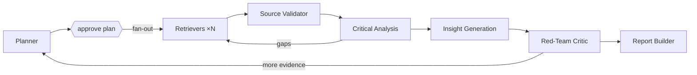

# Multi-Agent Deep Researcher

An AI research assistant for multi-hop, multi-source investigations, built on
[LangGraph](https://docs.langchain.com/oss/python/langgraph). A planner decomposes a hard
question, parallel retriever agents pull from papers, news, reports and APIs, a critical-analysis
agent cross-checks the evidence and flags contradictions, an insight agent proposes hypotheses
with reasoning chains, a red-team critic challenges them, and a report builder compiles a fully
cited report.

Showcases **agent collaboration**, **retrieval-augmented reasoning** (every claim cites a stored
evidence ID that is verified before the report ships) and **long-context synthesis**.

**Status:** planning + deployable skeleton. See [PLAN.md](PLAN.md) for the full design, agent
roster, graph, phases and Vercel architecture.

## Architecture



## Quick start (local)

```bash
uv sync --extra dev
cp .env.example .env            # fill in keys
uv run uvicorn api.index:app --reload
# open http://localhost:8000/api/health
```

The Gradio UI (`app/gradio_app.py`) and the LangGraph graph (`src/deep_researcher/`) land in
Phases 1–5 of the plan.

## Deploy to Vercel

The repo is Vercel-ready: `api/index.py` is a FastAPI function (Server-Sent Events streaming),
`public/index.html` is the hosted UI, and `vercel.json` sets `maxDuration` and `/api` rewrites.

```bash
npm i -g vercel
vercel link
vercel env add ANTHROPIC_API_KEY   # repeat for the variables in .env.example
vercel --prod
```

Or import the GitHub repo in the Vercel dashboard; pushes to `main` deploy automatically.

**Constraints that shape the hosted design** (details in PLAN.md §10):

- Functions are capped at 300 s on Hobby (800 s on Pro), so the API streams events immediately and
  honours `MAX_HOPS` / `RUN_BUDGET_SECONDS`.
- The filesystem is ephemeral, so hosted runs use a Postgres checkpointer and a Chroma server /
  Chroma Cloud (or another hosted store) instead of SQLite + the local Chroma directory. A local
  embedding model will not fit in a function, so set `EMBEDDINGS_PROVIDER=openrouter` there.
- Human plan approval is split into two requests: `POST /api/research` returns the plan and a
  `thread_id`; `POST /api/research/{thread_id}/resume` continues from the checkpoint.

## LLM provider: OpenRouter

All agents get their chat model from [`src/deep_researcher/llm.py`](src/deep_researcher/llm.py),
which routes through [OpenRouter](https://openrouter.ai). One key, any vendor, per-role model
choice, automatic fallbacks.

```bash
OPENROUTER_API_KEY=sk-or-...
```

| Tier | Roles | Default model | Override |
|---|---|---|---|
| heavy | planner, analysis, insight, critic | `anthropic/claude-opus-5.5` | `OPENROUTER_MODEL_HEAVY` |
| worker | retriever, report | `anthropic/claude-sonnet-5` | `OPENROUTER_MODEL_WORKER` |
| cheap | validator, grader | `anthropic/claude-haiku-4.5` | `OPENROUTER_MODEL_CHEAP` |

Any single role can be pinned with `OPENROUTER_MODEL_<ROLE>`, e.g.
`OPENROUTER_MODEL_INSIGHT=openai/gpt-5.1`. `OPENROUTER_FALLBACK_MODELS` lists backups tried in
order when the primary is unavailable, and `OPENROUTER_PROVIDER_ORDER` / `OPENROUTER_ZDR` /
`OPENROUTER_SORT` control provider routing. `/api/health` shows the resolved model per role.

```python
from deep_researcher.llm import get_llm
get_llm("planner").invoke("...")           # ChatOpenRouter, traced by LangSmith automatically
```

## Embeddings and the vector DB

Evidence is chunked, embedded and stored in a **persistent embedded Chroma** collection
(`CHROMA_PATH`, default `.chroma/`). The embedding model is chosen by `EMBEDDINGS_PROVIDER`, and
the default needs **no API key and no server**:

| Provider | Default model | Install | Notes |
|---|---|---|---|
| `local` (default) | `BAAI/bge-base-en-v1.5` (768-d) | `uv sync --extra embeddings-local` | sentence-transformers on CPU (CPU-only torch is pinned via `tool.uv.sources`); set `EMBEDDINGS_DEVICE=cuda`/`mps` to use a GPU |
| `openrouter` | `baai/bge-base-en-v1.5` (768-d) | `uv sync --extra embeddings-openai` | **Same weights as `local`**: identical vectors (cosine 1.0 measured), so collections are portable between laptop and cloud. Uses `OPENROUTER_API_KEY`. $0.005 / M tokens. Use this on AWS / Vercel. |
| `ollama` | `nomic-embed-text` | `uv sync --extra embeddings-ollama` | `ollama pull nomic-embed-text`; `EMBEDDINGS_BASE_URL` for a remote server |
| `openai` | `text-embedding-3-small` | `uv sync --extra embeddings-openai` | OpenAI, or any OpenAI-compatible endpoint via `EMBEDDINGS_BASE_URL` (vLLM, LM Studio) |

The store writes the embedding fingerprint (canonical model name, e.g. `baai/bge-base-en-v1.5`,
plus requested dimensions) and the vector dimension into the collection's metadata and refuses to
open it with a different model, so you cannot mix embeddings in one collection by accident. The
fingerprint is model-based rather than provider-based on purpose: `local` and `openrouter` serving
the same model share a collection. Chunk ids are deterministic, so re-ingesting a source is
an idempotent upsert. Chroma is embedded and single-writer; the same code talks to a Chroma server
or Chroma Cloud by swapping the client.

```python
from deep_researcher import embeddings
from deep_researcher.store import EvidenceStore

store = EvidenceStore(embeddings.get_embeddings(), embedding_id=embeddings.embedding_id())
store.add_evidence([...])                       # Evidence -> chunks -> vectors, persisted
hits = store.query("four-day week productivity", k=10, sub_question_id="sq1")
```

## Tracing with LangSmith

Set three variables (locally in `.env`, on Vercel in the project settings) and every request
becomes a LangSmith trace:

```bash
LANGSMITH_TRACING=true
LANGSMITH_API_KEY=lsv2_...
LANGSMITH_PROJECT=deep-researcher
```

What you get:

- One parent run per API call (`api.research`, `api.resume`) tagged `api` and `vercel`/`local`,
  with `thread_id` in metadata so a whole investigation can be filtered in one view.
- LangGraph node, tool and model calls nest under that parent automatically; retrievers use the
  `retriever` run type so LangSmith renders documents properly.
- The first SSE event carries `trace_url`, so the UI can link straight to the trace.
- `/api/health` reports `tracing.enabled` and the project, never the key.
- On Vercel the client is flushed before the function returns and LangChain callbacks run
  synchronously, so traces are not lost when the instance is frozen.

Tracing is a strict no-op when the variables are unset. The helpers live in
[`src/deep_researcher/tracing.py`](src/deep_researcher/tracing.py): `span()` for a parent run,
`traced()` for tools and agents, `run_config()` to name and tag a graph run, `flush()`.

## Protecting the API

The research endpoint spends real money per call, so three env vars guard it (all optional):

| Variable | Default | Effect |
|---|---|---|
| `API_AUTH_TOKEN` | unset (open) | When set, `POST /api/research*` require `Authorization: Bearer <token>` or `X-API-Key`. The hosted UI shows a token field when health reports `auth_required`. |
| `RATE_LIMIT_PER_MINUTE` | `6` | Sliding window per client IP; `0` disables. Idle keys are evicted so memory stays bounded. |
| `MAX_CONCURRENT_RUNS` | `3` | Simultaneous research streams per instance; extra requests get `503` with `Retry-After`. Released on every exit path, including client disconnects. |
| `TRUST_PROXY_HEADERS` | on when `VERCEL` is set, else off | Use `x-real-ip` / `x-vercel-forwarded-for` / `x-forwarded-for` as the rate-limit key. Off by default locally because those headers are forgeable without a proxy in front. |

Set `API_AUTH_TOKEN` on Vercel before sharing the URL. The limiter is in-process, which bounds
burst cost per instance; swap in Upstash/Redis if you need a global limit. `/api/health` stays
public and never exposes secrets.

## API

| Method | Path | Purpose |
|---|---|---|
| GET | `/api/health` | liveness + whether the graph is wired |
| POST | `/api/research` | `{question, max_hops?}` → SSE stream until plan approval |
| POST | `/api/research/{thread_id}/resume` | `{plan: ResearchPlan}` → SSE stream to final report |

SSE events: `started` (with `trace_url`), `plan`, agent events, `error`, `done`.

## License

No license has been chosen yet; all rights reserved until one is added.
